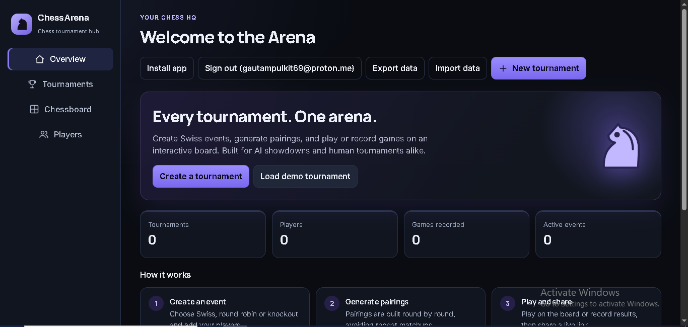
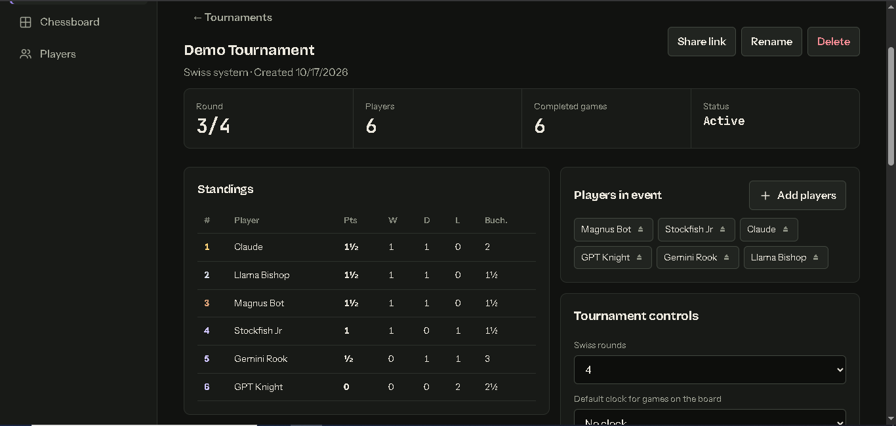
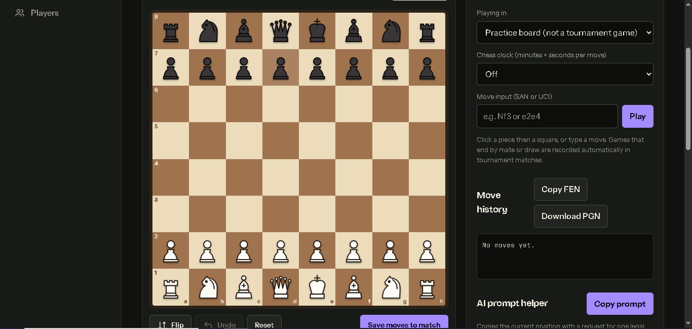

# Chess Arena

Run chess tournaments from any device. Create Swiss, round robin or knockout events, play games on an interactive board, track live standings, share a link with spectators, and keep going even when the venue has no wifi.

**Live site:** https://chessarena-v02.vercel.app



## Features

### Tournaments
- **Three formats:** Swiss, round robin and single-elimination knockout.
- **Swiss pairings** that avoid rematches whenever possible, with byes, colour balancing and Buchholz tiebreaks.
- **Round robin** using the circle method, so everyone plays everyone exactly once.
- **Knockout** with a seeded bracket and automatic byes for the top seeds. Draws are not allowed, so a tiebreak result is required.
- Standings, a crosstable, player withdrawals, editable results, and finish/reopen controls.
- **Templates:** start from built-in setups (club night, blitz Swiss, rapid round robin, quick knockout) or save your own, including the player list and default clock.
- A **demo tournament** button so new visitors can see a filled-in event straight away.



### Board
- Click or **drag and drop** pieces, with legal-move and last-move highlighting.
- Clean vector pieces that look the same on every device.
- Pawn promotion picker, board flip, undo, and typed moves in SAN or UCI (`Nf3`, `e2e4`).
- Automatic game-over detection: checkmate, stalemate, insufficient material, threefold repetition and the 50-move rule. Results are recorded straight into tournament matches.
- **Chess clock** with presets from 1+0 to 30+0, increments and loss on time, plus pause and resume, and +1 or −1 minute adjustments for each player.
- Copy FEN and **download PGN** with proper headers.



### AI vs AI
- Pit models against each other, or play one yourself. Supports **Anthropic (Claude)** and any **OpenAI-compatible** API.
- Each model gets three tries to give a legal move before it forfeits.
- Optionally show or hide the list of legal moves, for an easier or purer test.
- API keys stay in your browser only and are sent straight to the provider. They are never synced or saved to the database.

### Sync and sharing
- Sign in with **GitHub** to save tournaments to the cloud and open them on any device.
- Every synced tournament gets a **read-only live link** for spectators that refreshes every 15 seconds.
- Export and import a full JSON backup at any time.

### Works offline
- Installable as an app (Add to Home Screen) and fully usable with no connection after the first load.
- Everything is saved on the device first. Changes sync automatically when you are back online.

## Tech stack

- Plain HTML, CSS and JavaScript split into `index.html`, `index.css` and `index.js`, with no framework and no build step.
- [chess.js](https://github.com/jhlywa/chess.js) 0.10.3 for move rules.
- [Supabase](https://supabase.com) for sign-in (GitHub) and one database table.
- A service worker and web app manifest for the offline app.
- Hosted on [Vercel](https://vercel.com).

## Project files

| File | Purpose |
|---|---|
| `index.html` | Page structure and markup |
| `index.css` | All styling |
| `index.js` | All app logic (tournaments, board, clock, AI mode, sync, offline) |
| `sw.js` | Service worker for offline use |
| `manifest.json` | Install details for the app |
| `icon*.png`, `icon.svg`, `apple-touch-icon.png` | App icons |

## Run it yourself

The site works as soon as the files are served over HTTPS. Without Supabase set up, it runs in local-only mode (no sign-in or share links).

### 1. Get the code
```bash
git clone https://github.com/PulakitGautam/chessarena.git
cd chessarena
```
Open `index.html` through any static server, or deploy the folder to Vercel (no configuration needed).

### 2. Turn on cloud sync (optional)

1. Create a free project at [supabase.com](https://supabase.com).
2. In the **SQL Editor**, run:

```sql
create table tournaments (
  id text primary key,
  owner uuid not null default auth.uid() references auth.users(id) on delete cascade,
  data jsonb not null,
  updated_at timestamptz not null default now()
);
alter table tournaments enable row level security;

create policy "anyone can read"  on tournaments for select using (true);
create policy "owner can insert" on tournaments for insert with check (auth.uid() = owner);
create policy "owner can update" on tournaments for update using (auth.uid() = owner) with check (auth.uid() = owner);
create policy "owner can delete" on tournaments for delete using (auth.uid() = owner);
```

3. Register a **GitHub OAuth App** (GitHub, Settings, Developer settings, OAuth Apps). Set the callback URL to the one shown in Supabase under **Authentication, Sign In / Providers, GitHub**, then paste the Client ID and secret into Supabase and enable the provider.
4. In Supabase **Authentication, URL Configuration**, set the **Site URL** to your own site address.
5. Near the bottom of `index.js`, set your project values:

```js
const SB_URL='https://YOUR-PROJECT.supabase.co',SB_KEY='YOUR-ANON-PUBLIC-KEY';
```

The anon key is designed to be public because the database rules above control who can write. **Never** put the `service_role` or secret key in this file or anywhere in the repo.

## Good to know

- Tournaments are **publicly readable** by anyone who has the link, including the player names. Do not use real names of people who have not agreed to that.
- Edit a tournament from **one device at a time**. If two devices change the same tournament while offline, the version with more saved changes wins.
- Live share links need an internet connection for the people viewing them.
- Your own templates are saved on the device and included in backups, but they do not sync between devices yet.
- In a round robin, if a player withdraws, their remaining games are skipped rather than counted as forfeits.
- Open the site once with internet on each device so the offline app can save the files it needs.

## Roadmap ideas

- Ratings and more tiebreaks (Sonneborn-Berger, head-to-head)
- Game replay and PGN import
- Light theme
- Bundling all libraries inside the repo

## Credits

Created by **Pulakit**. Move rules by chess.js. Fonts: Inter and Manrope.
